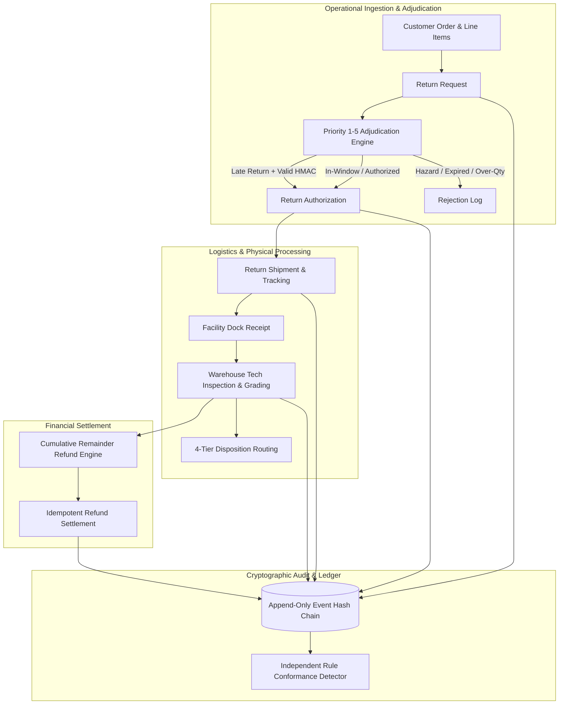

# YottaFlex: Enterprise Reverse Logistics & RMA Engine (ERL-RMA)

An enterprise-grade, deterministic reverse logistics and return merchandise authorization platform featuring fixed-point financial proration, cryptographic policy adjudication, an append-only hash-chained state ledger, and an independent rule-conformance audit engine.

---

## 1. System Architecture



---

## 2. Key Capabilities

- **Fixed-Point Financial Settlement**: All monetary values are represented strictly as integer cents (`*_cents`) and calculated via Banker's Rounding (`ROUND_HALF_EVEN`). Cumulative remainder distribution guarantees exact penny preservation ($0.00 drift) across partial multi-line returns.
- **Hierarchical Policy Adjudication**: Deterministic Priority 1–5 rule chain enforcing category prohibitions, strict window expiration boundaries, remaining returnable quantity validation, and HMAC-SHA256 manager overrides.
- **Append-Only Immutable Event Ledger**: Sequential state transitions are bound by SHA-256 cryptographic hash chains with database-level triggers blocking `UPDATE` and `DELETE` mutations.
- **Independent Heuristic Audit Engine**: Pure rule-based conformance auditing decoupled from ground truth labels, validated against a benchmark of 1,112 hard-negative boundary records with zero false positives.
- **Deterministic Benchmark Generation**: Seeded PRNG (`20261022`) generating byte-identical operational datasets across runs with 0 arithmetic or foreign key violations.

---

## 3. Financial Settlement Mathematics

When multiple items on a single order line are returned across separate batches, standard division produces rounding drift. ERL-RMA uses Hamilton-Hare cumulative remainder allocation:

$$\text{cum\_alloc}_k = \text{round\_half\_even}\left(\frac{\text{total\_discount} \times \sum_{i=1}^k q_i}{q_{\text{purchased}}}\right)$$
$$\text{slice\_discount}_k = \text{cum\_alloc}_k - \sum_{i=1}^{k-1} \text{slice\_discount}_i$$

### Worked Step-by-Step Example

Consider returning 1 of 3 items on an order line:
- Unit Price: `$80.00` (`8,000` cents)
- Line GMV (3 units): `$240.00` (`24,000` cents)
- Line Coupon Discount: `$15.00` (`1,500` cents)
- Line Sales Tax: `$18.00` (`1,800` cents)
- Net Line Paid: `$243.00` (`24,300` cents)
- Condition: `GRADE_B_OPEN_BOX` (15% restocking fee)

```
1. Slice GMV (1 unit)       = $80.00
2. Prorated Discount Share  = - $5.00   [round_half_even(1500 * 1 / 3)]
3. Net Merchandise Base     = $75.00   [$80.00 - $5.00]
4. Prorated Sales Tax       = + $6.00   [round_half_even(1800 * 1 / 3)]
5. Restocking Fee (15%)     = - $11.25  [round_half_even(7500 * 0.15)]
6. Shipping Fee Refund      = + $0.00   [Customer fault: CHANGED_MIND]
------------------------------------------------------------------------
Final Customer Net Refund   = $69.75   [Invariant: $69.75 <= $243.00 PASS]
```

Subsequent returns of units 2 and 3 reconcile to the total `$243.00` with 0-cent variance.

---

## 4. Quickstart

### Prerequisites
- Python 3.9+
- Node.js 20+

### 1. Install Dependencies
```bash
# Python dependencies
pip install -r requirements.txt

# Frontend dependencies
npm install
```

### 2. Generate Benchmark Dataset
```bash
# Generate scale 1.0 benchmark (30,000 orders, 5,000 requests, 250 anomalies)
python3 erl_rma_benchmark.py --seed 20261022 --scale 1.0 --out ./erl_rma_export

# Generate scale 0.1 starter dataset
python3 erl_rma_benchmark.py --seed 20261022 --scale 0.1 --out ./erl_rma_export_starter

# Verify bit-for-bit reproducibility
python3 erl_rma_benchmark.py --seed 20261022 --scale 0.1 --repro-check
```

### 3. Run Backend & Frontend Tests
```bash
# Run Python domain and audit tests
python3 -m unittest discover -s tests -p 'test_*.py'

# Run Frontend formatting and math tests
npx vitest run

# Run Frontend typecheck, lint, and build
npx tsc --noEmit
npx eslint .
npm run build
```

### 4. Start Development Services
```bash
# Terminal 1: Start REST API server (port 8000)
python3 api_server.py --db erl_rma_export/erl_rma.sqlite --port 8000

# Terminal 2: Start Vite dashboard
npm run dev
```

---

## 5. Documentation Suite

- [docs/AUDIT.md](docs/AUDIT.md) — Comprehensive technical audit findings and baseline verification.
- [docs/ADJUDICATION_RULES.md](docs/ADJUDICATION_RULES.md) — Specification of Priorities 1–5 and window boundary rules.
- [docs/REFUND_MATH.md](docs/REFUND_MATH.md) — Fixed-point proration formulas, Banker's rounding, and worked proofs.
- [docs/LIFECYCLE.md](docs/LIFECYCLE.md) — Complete state machine transitions, disposition matrix, and SoD rules.
- [docs/EVALUATION.md](docs/EVALUATION.md) — Independent detector evaluation vs. benchmark ground truth and hard negatives.
- [docs/DECISIONS.md](docs/DECISIONS.md) — Architectural Decision Records (ADRs).
- [docs/DATA_DICTIONARY.md](docs/DATA_DICTIONARY.md) — Schema table specifications, column data types, and nullability.
- [docs/CHANGELOG.md](docs/CHANGELOG.md) — Release history and migration notes.
