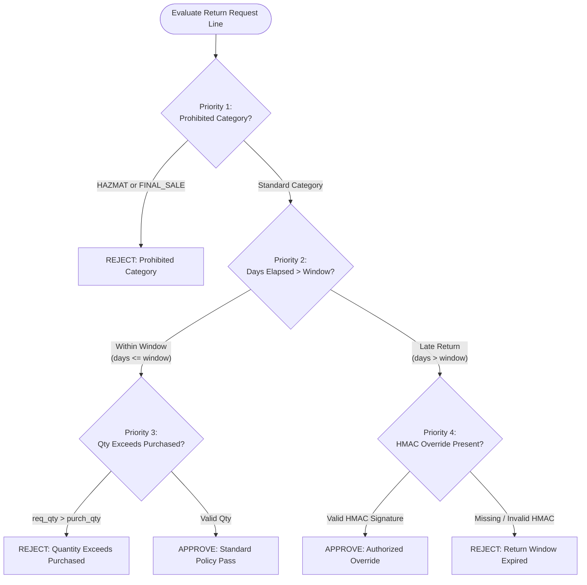

# ERL-RMA Adjudication Rule Hierarchy Specification

## 1. Overview
Policy adjudication determines whether a return request is authorized, rejected, or routed for managerial review. Evaluation is performed deterministically using a prioritized rule engine.

When a line is evaluated, rules are tested strictly from **Priority 1** through **Priority 5**. The first triggered rule terminates the evaluation chain.

---

## 2. Priority Rule Chain

### Priority 1: Non-Returnable Category Auto-Rejection
- **Rule**: If `category IN ('FINAL_SALE', 'HAZMAT')`, the item is inherently non-returnable.
- **Outcome**: Immediate `REJECTED`.
- **Reason Code**: `CATEGORY_NOT_RETURNABLE`.
- **Precedence**: Overrides return window, manager status, or order age.

### Priority 2: Return Window Expiration Check
- **Rule**: Calculate calendar elapsed days between order delivery date and return request date:
  $$\Delta = \text{request\_date} - \text{delivery\_date}$$
- **Window Thresholds by Category**:
  - `ELECTRONICS`: 15 calendar days
  - `APPAREL`: 30 calendar days
  - `HOME`: 30 calendar days
- **Exact Boundary Definition**:
  - If $\Delta \le \text{return\_window\_days}$: **ELIGIBLE (Within Window)**.
  - If $\Delta > \text{return\_window\_days}$: **EXPIRED (Late Return)**.
  - *Hard Boundary Example*: On Day 30 for an APPAREL item, $\Delta = 30 \le 30 \implies$ **APPROVED** (within policy window). On Day 31, $\Delta = 31 > 30 \implies$ **EXPIRED**.

### Priority 3: Quantity Authorization Check
- **Rule**: Requested quantity must not exceed the remaining returnable quantity:
  $$q_{\text{requested}} \le q_{\text{purchased}} - q_{\text{prior\_returned}}$$
- **Outcome**: If $q_{\text{requested}} > q_{\text{available}}$, immediate `REJECTED`.
- **Reason Code**: `QUANTITY_EXCEEDS_PURCHASED`.

### Priority 4: Cryptographic Manager Override Verification
- **Rule**: If an item fails Priority 2 (late return), it may only be approved if accompanied by a valid cryptographic HMAC-SHA256 signature token.
- **Token Format**:
  $$\text{token} = \text{manager\_id} \mathbin{\Vert} \text{issued\_at} \mathbin{\Vert} \text{HMAC-SHA256}_{K}(\text{order\_id} \mathbin{\Vert} \text{line\_id} \mathbin{\Vert} \text{manager\_id} \mathbin{\Vert} \text{issued\_at})$$
- **Verification Criteria**:
  1. `manager_id` belongs to an active supervisor (`MGR-*`).
  2. Signature matches SHA-256 HMAC generated using server secret key.
  3. `issued_at` timestamp is within 7 days of request timestamp.
- **Outcome**:
  - If token valid: `APPROVED` under `OVERRIDE_APPROVED`.
  - If token invalid or missing: `REJECTED` under `WINDOW_EXPIRED`.

### Priority 5: Standard Authorization Approval
- **Rule**: If all preceding checks pass, the return is authorized.
- **Outcome**: `APPROVED`.
- **Next Steps**: RMA identifier issued, carrier shipping label generated, return tracking initialized.

